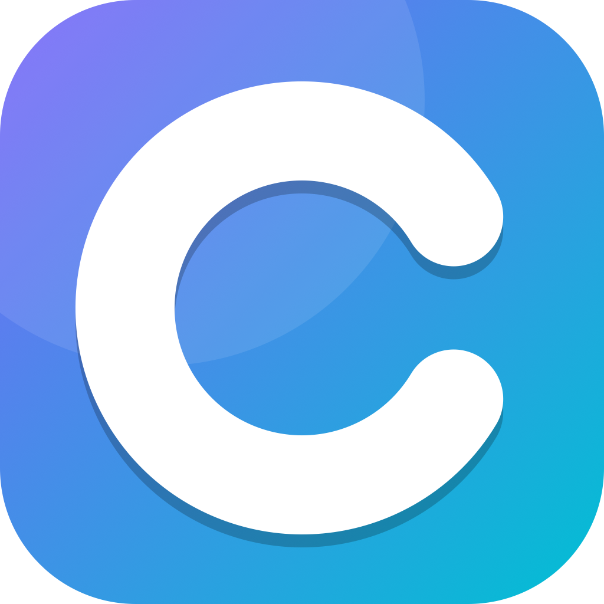

<p align="center">
  
</p>

<h1 align="center">Chikit</h1>

<p align="center">
  A small macOS menu bar app with the handful of utilities I actually use.<br>
  Everything runs on your Mac. No account, no analytics, no update pings.
</p>

<p align="center">
  <a href="https://github.com/stays0ft/chikit/actions/workflows/ci.yml"></a>
  
  <a href="LICENSE"></a>
</p>

Chikit lives in the menu bar and opens a translucent panel. It started as a fork of
[Vorssaint](https://github.com/vorssaintapp/vorssaint-utils) and was cut down to a focused set of
tools, with its own name, icon and look. See [Origin and licensing](#origin-and-licensing).

## What it does

**Windows**
- **Window layout.** Snap the active window to the left, right, top or bottom half, to any of the four
  corners, or maximize it, with shortcuts or by dragging to a screen edge. The shortcuts match
  [Rectangle](https://rectangleapp.com) so muscle memory carries over (see below).
- **Quit on close.** Apps you choose quit when their last window closes.

**Clipboard and files**
- **Clipboard history.** A local history of what you copy (text, images, files) with search, pinned
  favorites and quick paste. Apps you choose are never recorded.
- **Finder rename.** Rename the selected file or folder with a shortcut you pick.
- **File converter.** Convert audio, video, images, documents, PDFs and Excel sheets between formats,
  from the panel or the Finder Services menu.

**Sound**
- **Volume mixer.** A slider for every app, exact percentages, and a boost past 100 percent for a quiet
  video.
- **Output switcher.** Send different apps to different outputs, and cycle outputs with a shortcut.

**Monitoring**
- **System monitor.** CPU, GPU, memory, network, disk and power, with history graphs, temperatures,
  battery health and optional alerts. Each metric is its own switch.
- **Fan control** (beta). Manual speeds or temperature curves with live RPM, where the hardware allows it.

**Tools**
- **Screen recorder.** Record an area, a window or the whole screen, with optional system sound and
  microphone, then edit: trim and cut, automatic zoom, blur an area, backdrops, text, export to video
  or GIF.
- **Cleaner.** Find caches, logs, leftovers of apps that are no longer installed and old device backups.
  Everything goes to the Trash, and you can exclude paths or apps from future scans.
- **Uninstaller.** Drop an app in and move it, with its preferences, caches, containers and other
  leftovers, to the Trash. Matching is by bundle identifier, and name-only matches start unchecked.
- **Notch media controls.** Now-playing title, artist and artwork with play, pause and skip, in a small
  widget at the notch (docked under the menu bar icon on Macs without one). Off by default.

You can install and uninstall whole features from **Settings, Features**. What you turn off disappears
from the app and stops running entirely.

### Window layout shortcuts

| Action | Shortcut |
|---|---|
| Left / right half | Control Option Left / Right |
| Top / bottom half | Control Option Up / Down |
| Top left / top right | Control Option U / I |
| Bottom left / bottom right | Control Option J / K |
| Maximize | Control Option Return |

All of them can be changed or cleared in Settings.

## Requirements

- macOS 14 or newer, on Apple silicon.
- Xcode or the Xcode Command Line Tools (Swift 6) to build it. There are no prebuilt downloads.

## Install

```sh
git clone https://github.com/stays0ft/chikit.git
cd chikit
./build.sh --install
```

This builds the app, signs it and copies it to `/Applications/Chikit.app`. Open it from there.

**Keep your permissions across rebuilds.** By default the build is ad hoc signed, so macOS treats every
rebuild as a different app and asks for Accessibility and Screen Recording again. Run this once to create
a local signing identity and every later build keeps its permissions:

```sh
./Tools/setup-signing.sh
```

## Permissions

Everything is optional, and the Features page shows which feature uses which permission.

| Permission | Used by | Without it |
|---|---|---|
| Accessibility | Window layout, quit on close, Finder rename, mixer shortcuts, screen recorder | Those features stay off |
| Screen Recording | Screen recorder | Recording is unavailable |
| System Audio Recording | Volume mixer, output switcher | Apps stay on normal system audio |
| Microphone | Optional voice track in recordings | Recordings carry no voice |
| Notifications | Monitor and cleaner alerts | The app stays silent |
| Full Disk Access | Deeper cleaner and uninstaller scans | Only reachable places are scanned |
| Automation (Finder) | Cleaner and uninstaller (moving items to the Trash), Finder rename | Those actions are unavailable |

More detail in [docs/PERMISSIONS.md](docs/PERMISSIONS.md).

## Privacy

Chikit does not phone home. The only network requests it can make are a speed test you start
(Cloudflare's public endpoint) and, in the Uninstaller, a read-only lookup of Homebrew's public
package popularity data. See [docs/PRIVACY.md](docs/PRIVACY.md).

## Uninstall

From the app: **Settings, Advanced, Uninstall**. Or from a terminal, which also removes preferences
and permissions:

```sh
./Tools/uninstall.sh
```

## Development

```sh
swift build                    # compile
./build.sh --test              # unit tests (no app, no UI)
./build.sh && ./build/Chikit --selftest   # build the bundle and run the built-in self test
```

The code lives in `Sources/Vorssaint/` (the module keeps its inherited name): `Core` for shared types,
strings and defaults, `Services` for the features' logic, `UI` for SwiftUI views and `App` for the menu
bar shell. Contributions are welcome, see [CONTRIBUTING.md](CONTRIBUTING.md).

## Origin and licensing

Chikit is a modified version of [Vorssaint](https://github.com/vorssaintapp/vorssaint-utils) by its
maintainer, whose original work is licensed under the GNU GPL version 3 or later. Chikit is distributed
under the same license, see [LICENSE](LICENSE), and keeps the original copyright notices in the source
files. It is an independent personal project, not affiliated with or endorsed by Vorssaint, and it uses
its own name, icon, bundle identifier and signing identity as the original project's
[trademark notice](TRADEMARKS.md) requires. Changes from the original are listed in
[CHANGELOG.md](CHANGELOG.md) and in the git history.
